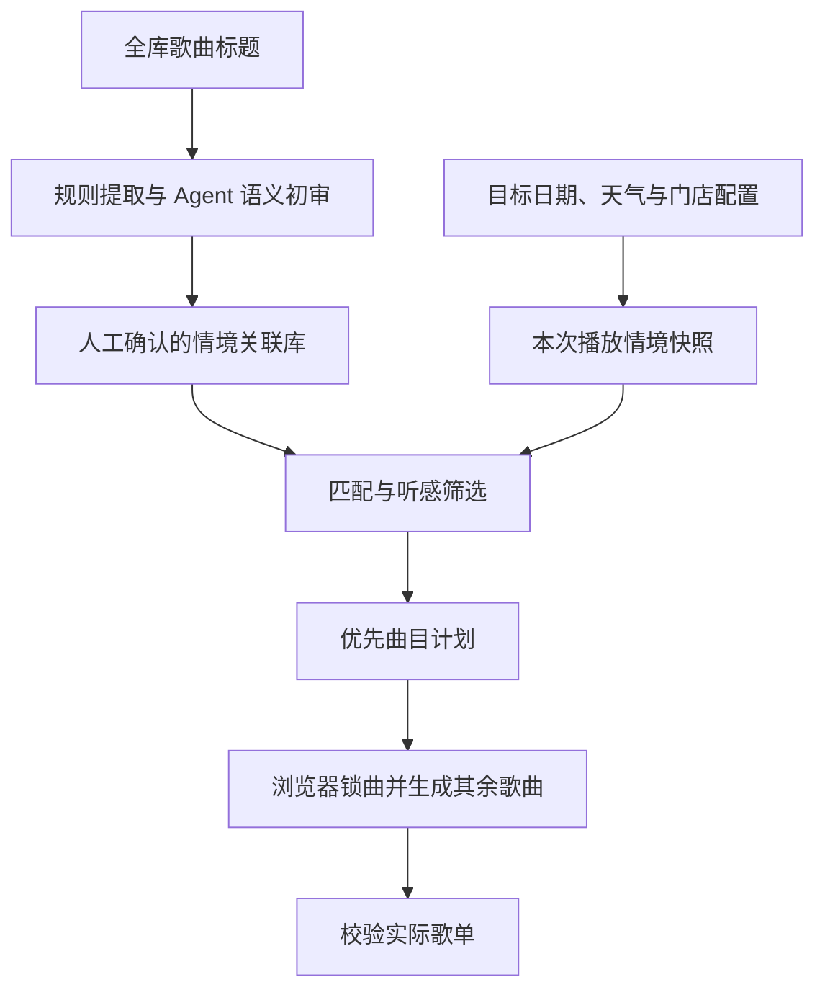

# 情境关联功能需求与歌单生成影响

记录日期：2026-10-12。本文记录已讨论的需求与范围，并提出后续接入设计；标为“建议”或“待实现”的内容不代表已开发完成，也不代表参数已确定。

## 一、需求与边界

这个功能是一层“情境策展”：生成歌单前，程序读取目标播放日期、节日、节气、季节和天气等信息，从歌曲的情境关联库里挑出少量值得优先出现的歌曲，交给 Agent 操作歌单生成浏览器，将选定歌曲锁定入选，再生成其余曲目。

情境层回答“为什么今天、这个时段放这首歌”；曲风、个人听感和衔接层回答“它听起来是否适合门店、能否接得自然”。情境层补充现有生成机制，不替代它，也不把全天歌单变成应景关键词合集。

首版从歌曲名开始。标题中明确出现某个意象，可以建立“标题关联”，但不证明歌词主题、创作意图、情绪或播放适配。纯音乐也可以有标题关联；未命中不等于作品没有相关内容。

当前范围分为六类：

| 类别 | 保留方向 | 匹配注意点 |
|---|---|---|
| 四季 | 春、夏、秋、冬、四季流转及少量间接物候线索 | 月份不自动推出季节；当地季节与体感需要区分 |
| 天气与体感 | 雨、雾、晴、阴、天气变化、冷暖等现有规则 | 标题里的冷暖可能是比喻，需复核；保留霜、风暴、雷电等未排除项 |
| 节日与纪念情境 | 圣诞、新年、传统节日、假日、祝贺等 | 泛假日不绑定具体节日，生日标题不等于艺人生日事实 |
| 月份与日期 | 月份、明确日期、星期、周末 | 日期保留年份，历法及是否每年重复需确认；周末不等于调休后的休息日 |
| 二十四节气 | 明确的节气关联 | 谷雨不等于当天降雨；小雪、白露等需区分普通词义与节气 |
| 时段与天光 | 早晨、上午、下午、傍晚、黄昏、日出、日落、太阳、阳光、明确钟点等 | 只在门店实际播放区间内考虑；月光、午夜等未列出的规则仍保留，不代表一定触发 |

用户已明确排除以下 14 类，后续重扫和匹配不应恢复：

| 分组 | 排除的情境 |
|---|---|
| 天气 | 冰意象、露水意象、云意象、雪意象、风意象 |
| 时段 | 夜晚、黎明之前、黎明、无 AM／PM 的钟点候选 |
| 天光 | 天空意象（无天气判定）、月亮意象、极光／曙光候选、泛光意象（无具体时段） |
| 事件 | 毕业纪念 |

排除的是关联标签，不是歌曲。其他关联照常保留，例如《Summer Nights》仍可因夏季进入候选，《Morning Dew》仍可因早晨进入候选。月光、傍晚风歇、日出和白露／小雪节气等没有被列入排除范围，不扩大删除。

## 二、数据与处理流程

建议拆成“离线建设关联库”和“生成前匹配情境”两条流程，避免每次生成都让 Agent 重新研究全库。

离线阶段的要求：

1. 以稳定歌曲 ID 关联数据，保留原标题；统一大小写、全半角和有限繁简字形用于检索，避免英文子串和单字误命中。
2. 提取只看歌曲标题，合作艺人和明确技术版本段不提供主题证据；规则先找候选，Agent 再处理词义、短语和多语言歧义。
3. 每条关联保留标准标签、命中文字、原文位置、依据类型、判断理由、规则版本及人工复核状态。标题关联与将来的歌词依据、官方介绍、人工听感应分别记录。
4. 区分“明确标题关联”“间接线索”“语义待确认”。明确不等于已获用户批准；只有人工确认的关联才能进入正式匹配。人工确认结果独立保存，不因重扫覆盖。
5. 始终应用排除清单，允许歌曲没有关联，不为了覆盖率强行解释；标题日期不是发行日期，带年份日期不默认年度重复。

生成前需要采集的信息：

| 信息 | 建议来源与要求 |
|---|---|
| 门店位置、时区、营业时段 | 门店配置；使用门店位置而非电脑默认位置 |
| 目标日期、月份、星期 | 按目标播放日期计算，不简单使用生成时的当前日期 |
| 节日、节气、季节 | 地区节日表、可靠历法或节气计算；明确目标年份、历法和季节口径 |
| 天气与温度 | 目标播放区间的实况或逐小时预报，保留来源、采集时间和有效区间 |
| 日出、日落 | 按门店经纬度、目标日期和时区计算，不把日落固定为某个钟点 |

将这些信息整理成一次可保存的“播放情境快照”。天气接口可含云量、风速等原始字段，但不能因此恢复已排除的选曲标签；原始天气字段与情境关联范围是两件事。

正式匹配建议依次执行：排除未确认关联，匹配目标情境，检查歌曲可用性与门店听感，控制近期重复和主题配额，选出锚点及备选，再输出结构化优先曲目计划。每首应包含歌曲 ID、命中理由、适用区段、入选方式和冲突处理说明。

信息缺失或过期时，不猜天气、不硬套节气。缺失哪一项就跳过该项；完全没有合适匹配时，使用原有生成流程。

## 三、理论上如何影响歌单生成

### 选曲：从纯听感排序增加“此时有理由出现”

建议区分两种作用：软优先为合适歌曲增加有上限的情境分；锁定入选是先从合格候选中选出少量锚点，再要求本次生成保留这些歌曲。不是每首命中歌曲都必须锁定。

概念上可以是“原有听感得分＋受配额约束的情境加分”。具体权重尚未确定；日期或节日等具体关联可以比宽泛季节更有辨识度，但不能让情境分压倒门店听感、可播放性或时长限制。未标注听感也不能视为自动合格。

同一个依据不机械重复加分：例如“五月九日＋五月”来自一个日期，“阵雨间歇转晴＋雨＋晴”来自一个天气过程，应合并考虑。同一歌曲只入选一次。

### 排序：锁定入选不等于锁在最前面

锁定应区分“必须包含”“安排在某个区段”“固定位置”。通常只要求包含并满足适用区段，生成器仍能调整前后曲目保证衔接；只有确有需要时才固定位置。

日落关联适合留在接近日落的区段，早晨关联只影响实际早晨播放部分。明确 02:00 的标题虽然仍有候选规则，但门店若不在该时段播放，就不应触发。

安排后须按歌曲时长累计计算预计播放时间，复核锚点是否仍在窗口内。情境关联不能证明衔接自然，应继续使用已有听感判断和衔接依据；没有衔接证据时保留不确定性。

### 时长与多样性：锚点占用预算，不额外堆进去

锚点是目标歌单的一部分，其时长应从总预算扣除，其余歌曲填剩余时长。假设两小时歌单选出总共八分钟的锚点，其余部分应围绕剩余 112 分钟生成，而不是先生成两小时再额外插入。

锚点若原本已经入选，只保留一次；任何增删和重排后都重新核对总时长。主题配额、艺人重复、近期播放冷却仍需约束，避免雨天连续多日重复同几首歌，也避免单一主题挤占风格多样性。

配额、冷却天数、情境权重、节日预热窗口、时间窗口容差、年度日期复现等均待确定，不将讨论中的示例视为已定参数。

### 执行与解释：先做决策，再让 Agent 落实

Agent 根据优先曲目计划操作正在开发的歌单浏览器，核对准确曲目和版本，锁定后再生成其余歌曲。普通重新生成应保留已选锚点；无法完成锁定或发生约束冲突时，应明确报告，不静默取消，也不重复添加。

最终校验实际歌曲 ID、锁定状态、重复、总时长和适用区段，并保存情境快照、计划及执行结果。生成或锁定不等于实际播放，不应直接写成已播放历史。

以下均是假设相关关联已人工确认的设计示例，不代表已经生成或验证了歌曲听感：

| 情境 | 可能产生的影响 |
|---|---|
| 九月 | 《September》获得月份优先，不额外推成秋季主题 |
| 播放时段有雨 | 《骤雨》或《落雨》成为雨意象候选，不因此推成悲伤听感 |
| 目标区间覆盖日落 | 《夕阳消失之前》可作为接近日落区段的锚点，不一定在开头 |
| 目标日期是惊蛰 | 《惊蛰》获得节气优先，不意味着当天打雷或下雨 |
| 情境未命中或信息不可用 | 没有情境锚点，按原有机制生成 |

整体预期是“保留原有听感骨架，加入少量能解释为什么今天放的歌曲”，而不是建立另一套全面替代原算法的生成器。

## 四、现状、接入与验收

截至记录日期，已完成全库标题扫描、Agent 标题语义初审、独立候选报告和累计 14 类排除。规则版本为 `2026-10-12.3`，扫描 1,161 首唯一歌曲，当前保留 100 首候选、115 条关联；所有关联仍待用户复核，自动锁曲与触发建议均关闭。

尚待实现：人工确认结果的正式存储与导入、运行时情境采集、匹配决策、优先曲目计划，以及与浏览器锁曲流程的接通。用户已说明浏览器锁曲部分在另外开发，本目录不能据此宣称已接入可用。

现有两类歌单流程也需区分：

- [cafe_playlist.py](F:/SystemPlayerInvestigation/cafe-playlist/cafe_playlist.py) 与 [scheduler_engine.py](F:/SystemPlayerInvestigation/cafe-playlist/scheduler_engine.py) 是专辑级排播。歌曲级关联不能因为一首歌命中就让整张专辑入选；接入时必须能约束实际曲目、去重并核算时长。
- [build_2h_playlist.py](F:/SystemPlayerInvestigation/Flowset-个人审美打标-Demo/build_2h_playlist.py) 是预设曲目与顺序的 Flowset 示例歌单，不是现成的全库情境排序引擎。情境锚点需要通过正在开发的生成流程或独立适配层接入。

后续验收建议：

- 未确认、已否决及累计排除的关联不能自动影响歌单；重扫不覆盖人工确认。
- 同一曲目只出现一次；已选锚点能够保留，冲突及执行失败可解释。
- 锚点不额外突破总时长、不越过门店听感与播放区间要求。
- 每个优先入选都有可追溯的歌曲依据和本次情境依据。
- 关闭功能或没有有效匹配时，回退原生成流程；比较结果时固定输入、随机种子和情境快照。
- 情境匹配、浏览器执行和真实播放分别记录，不互相冒充完成状态。

当前规则及结果入口见 [title_context_rules.json](F:/SystemPlayerInvestigation/SongBase/context_associations/title_context_rules.json)、[title_context_candidates.json](F:/SystemPlayerInvestigation/SongBase/context_associations/scans/2026-10-12/title_context_candidates.json) 和 [title_context_report.html](F:/SystemPlayerInvestigation/SongBase/context_associations/scans/2026-10-12/title_context_report.html)。
