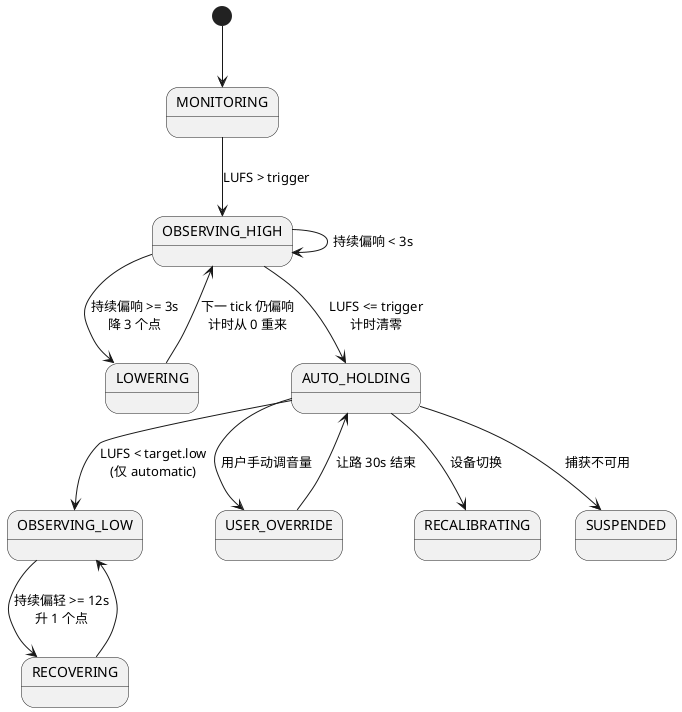

# 响度判断与动态调节策略说明

> 日期：2026-10-13
> 对应代码：`src/controller.py`（`controller-m0-m2/v1`）、`src/service.py`、`src/windows_monitor.py`
> 性质：现状审计 + 优化建议。本文描述的是代码当前真实行为，不是设计文档中的目标行为。

## 0. 一句话结论

当前策略是：**用 Short-term LUFS 判断，连续超过触发阈值满 3 秒才动作，每次固定降 3 个百分点，阶梯式下降，每一级都要重新攒满 3 秒证据**；峰值不参与决策，**没有任何提前截取突发峰值的能力**，按现有“改系统主音量”的架构也不可能做到真正的提前截取。

另外，真实平台目前拿不到 LUFS（恒为 `null`），所以控制器在 Windows/macOS 上实际一次都不会动作，以上策略目前只在模拟器和离线回放中生效。

## 1. 响度是怎么判断的

### 1.1 采集与计算链路

```text
WASAPI loopback 回调（1024 帧 / 次，48 kHz 约 21 ms）
   → PCMWindow 累加平方和与最大绝对值
   → 每 250 ms 汇总一次：RMS dBFS、Peak dBFS
   → service 每 250 ms tick 一次，调用 controller.step()
```

| 指标 | 现状 | 是否参与决策 |
|---|---|---|
| RMS dBFS（250 ms 窗口） | Windows/macOS 真实输出 | 只用于静音门判断 |
| Peak dBFS（250 ms 内采样最大值） | 真实输出 | 不参与，只显示和记录 |
| Momentary LUFS（400 ms） | 真实平台为 `null`；模拟器有假值 | 不参与，只记录 |
| Short-term LUFS（3 s） | 真实平台为 `null`；模拟器有假值 | **唯一的调节依据** |

代码位置：
- 真实平台 LUFS 为空：[windows_monitor.py:258](src/windows_monitor.py#L258)
- 决策只看 `shortTermLufs`：[controller.py:212-221](src/controller.py#L212-L221)

### 1.2 静音门

以下任一成立即视为“静音/不可判断”，清空所有计时，**禁止任何升降**：

- 平台报告 `isSilent = true`（Windows 当前用 RMS ≤ -90 dBFS 判断，[windows_monitor.py:262](src/windows_monitor.py#L262)）；
- RMS ≤ `silenceGateDbfs`（默认 -55 dBFS）；
- Short-term LUFS 缺失。

代码：[controller.py:214](src/controller.py#L214)

### 1.3 判断前的优先级拦截

`step()` 按以下顺序短路，前面命中就不会走到响度判断（[controller.py:162-210](src/controller.py#L162-L210)）：

1. 捕获不可用 → `SUSPENDED`
2. 设备 ID 变化 → `RECALIBRATING`，基准音量重置为新设备当前音量
3. 用户手动改音量 → `USER_OVERRIDE`，基准更新，让路 `manualOverrideSeconds`
4. 模式为 `monitor` → 只记录不动作（真实平台被服务端强制锁在这里，[service.py:139](src/service.py#L139)）
5. 仍在让路倒计时 → 阻止
6. 设备不可控 / 读不到系统音量 → `UNSUPPORTED`
7. 静音门 → 阻止

## 2. 回答你的几个问题

### Q1：是“达到某个分贝就降”，还是“一定时间内达到某个分贝才降”？

**后者，而且是“连续”保持，不是“窗口内累计”。**

- 条件：`shortTermLufs > triggerLufs`（默认 -15 LUFS）。
- 从第一次超过开始计时，**中间只要有一个 tick 回落到阈值以下（或遇到静音），计时立即清零**。
- 连续满 `lowerSustainSeconds`（默认 3 s）才触发一次下降。

由于 Short-term LUFS 本身就是 3 秒滑动窗口，实际“从内容变响到第一次动作”的延迟大约是 **LUFS 窗口爬升时间（最长约 3 s）+ 持续确认 3 s ≈ 3–6 秒**。

### Q2：对突然爆发的瞬间有没有提前截取能力？

**没有，而且当前也没有任何针对瞬时峰值的反应。**

- Peak dBFS 只记录不决策；需求 REQ-06 中的“极端峰值保护”尚未实现。
- 一次 1–2 秒的爆发在 3 秒 Short-term 窗口里会被平均掉，基本到不了触发阈值；即使到了，也需要再持续 3 秒。这是有意为之（保留音乐动态），但也意味着真正刺耳的突发会被完整播出。
- **架构上不可能提前截取**：loopback 拿到的是“已经送往扬声器”的音频，程序看到峰值时它已经在播了。改系统音量只能“事后反应”，最快也要 回调延迟 + 汇总窗口 + 写入生效 ≈ 50–300 ms。
- 真正的“提前截取”只能靠 DSP 层的 look-ahead 限制器：先把音频缓存几毫秒，发现峰值后在它播出前衰减。代价是接管音频路由并引入延迟，对应 `MONITORING_AND_SUPPRESSION.md` 的层级 C，Windows 上需要 APO 或虚拟声卡。

### Q3：往下降是阶梯式还是一次性拉到目标值？

**阶梯式，固定步长，每级都要重新攒证据。**

- 每次下降 `lowerStepPercent`（默认 3 个百分点），下限为 `minSystemVolume`（默认 20%）。
- 触发后 `over_since_ms` 被清空（[controller.py:229](src/controller.py#L229)），下一级必须再次连续偏响满 3 秒。
- 因此节奏是：**每 3 秒左右降 3 个点，约等于 1 个百分点 / 秒**。

离线回放验证（`python src/replay.py --mode lower-only --scenario loud`，1 秒步进）：

| 时间 | 系统音量 | 状态 |
|---|---|---|
| 0–2 s | 67 | OBSERVING_HIGH（攒证据） |
| 3 s | 67 → 64 | LOWERING |
| 4–6 s | 64 | OBSERVING_HIGH（重新攒证据） |
| 7 s | 64 → 61 | LOWERING |
| 11 s | 61 → 58 | LOWERING |
| … | 持续每 4 s 降 3 点，直到场景结束或触到 20% | |

步长是“系统音量百分比”，不是 dB，也不按“离目标差多少”计算，所以：**偏响 1 LU 和偏响 10 LU 的下降速度完全一样**。

### Q4：什么时候停止下降？什么时候回升？

- 停止下降：Short-term LUFS 回到 `triggerLufs` 以下。**注意不是回到目标区间上沿 `targetLufs.high`**。
- -21 ~ -15 LUFS 这一段全部是“保持区”，什么都不做。`targetLufs.high` 在决策中**完全没有被使用**，只在设置校验时要求 `triggerLufs ≥ targetLufs.high`。
- 回升（仅 `automatic` 模式）：Short-term LUFS 连续低于 `targetLufs.low`（-21）满 `recoverySustainSeconds`（12 s），每次 +`recoveryStepPercent`（1 点），上限 = min(`maxSystemVolume`, 用户基准音量)。
- 用户基准音量 = 程序启动/设备切换时的音量，或用户最近一次手动设的音量。

### 状态流转示意



## 3. 配置方式

### 3.1 参数表

默认值见 [controller.py:21](src/controller.py#L21)，校验规则见 [controller.py:48](src/controller.py#L48)。

| 字段 | 含义 | 默认 | 允许范围 | 实际是否生效 |
|---|---|---|---|---|
| `mode` | `monitor` / `shadow` / `lower-only` / `automatic` | `monitor` | 四选一 | 真实平台强制 `monitor` |
| `triggerLufs` | 超过多少开始算偏响 | -15 | -70..0，且 ≥ `targetLufs.high` | 是 |
| `targetLufs.low` | 低于多少开始算偏轻 | -21 | -70..0 | 是（仅回升） |
| `targetLufs.high` | 目标区间上沿 | -17 | -70..0，> low | **否，仅用于校验** |
| `minSystemVolume` | 自动降低不低于 | 20 | 0..100 | 是 |
| `maxSystemVolume` | 自动恢复不高于 | 75 | 0..100，> min | 是（仅回升） |
| `lowerStepPercent` | 每级下降多少点 | 3 | 0.1..20 | 是 |
| `recoveryStepPercent` | 每级回升多少点 | 1 | 0.1..10 | 是 |
| `lowerSustainSeconds` | 连续偏响多久才降一级 | 3 | 0.25..60 | 是 |
| `recoverySustainSeconds` | 连续偏轻多久才升一级 | 12 | 1..300 | 是 |
| `manualOverrideSeconds` | 用户手动调后让路多久 | 30 | 0..600 | 是，但真实平台检测不到手动调节 |
| `silenceGateDbfs` | RMS 低于多少视为静音 | -55 | -100..-20 | 是 |

不可配置、写死在代码里的：tick 间隔 250 ms（[service.py:130](src/service.py#L130)）、Windows 汇总窗口 250 ms 与静音阈值 -90 dBFS、PCM 缓冲 1024 帧。

### 3.2 四种修改途径

1. **监控网页**：`http://127.0.0.1:8765` 右侧“快速设置”表单，保存即生效并持久化。
2. **HTTP 接口**：支持部分字段更新，服务端完整校验。

   ```powershell
   Invoke-RestMethod http://127.0.0.1:8765/api/settings -Method Post -ContentType 'application/json' -Body '{"lowerStepPercent":2,"lowerSustainSeconds":4}'
   ```

3. **配置文件**（服务停止时编辑，启动时读取并校验）：
   - 模拟模式：`runtime/settings.json`
   - Windows：`runtime/windows-settings.json`
   - macOS：`runtime/macos-settings.json`
4. **离线回放**：`python src/replay.py --settings 某文件.json --mode lower-only --scenario loud`，用来在不碰设备的情况下比较参数。

## 4. 发现的问题

按严重程度排序。

### P0：降音量后测量值可能不变，导致一路降到底

控制器默认“降了音量 → 测到的响度会下降 → 停止”。但：

- 离线回放和模拟器里，场景的 LUFS 不随音量变化，结果是每 4 秒降 3 点一直降到 20%。
- Windows 实测时系统音量只有 14%，RMS 却在 -22 ~ -33 dBFS，这个电平更像是**音量调节之前**的信号。如果确认 WASAPI loopback 在这台设备上是“音量前”抓取，那么真实闭环也会出现同样的问题：只要内容本身偏响，音量就会一路降到 `minSystemVolume`。

这正是 README 第 4 节要求“必须先验证”的事实，目前没有验证，控制器也没有任何补偿。

### P1：真实平台没有 LUFS，控制器实际不工作

真实平台 `shortTermLufs` 恒为 `null`，会被静音门拦截。要等 M5 实现 K 加权 + 400 ms / 3 s 窗口后才能闭环。

### P1：没有峰值保护

REQ-06 要求“持续过响较快下降，极端峰值触发保护”，目前 Peak 完全不参与决策，突发巨响（广告、通知音、视频爆炸声）无任何反应。

### P2：固定百分比步长与听感不匹配

- 系统音量百分比和 dB 不是线性关系。Windows 的 scalar 在低音量区每 1% 对应的 dB 变化远大于高音量区：在 14% 时降 3 点可能是 3–4 dB，在 70% 时降 3 点可能不到 1 dB。
- 步长与偏离程度无关：偏响 10 LU 也要 30 秒以上才能降到位，“明显更响的来源切进来”时反应过慢。

### P2：目标区间上沿没用上，回差设计不清晰

降到 `triggerLufs` 以下就停，`targetLufs.high` 形同虚设。真实结果是长期停在 -15 附近，而界面显示的目标是 -21 ~ -17，与用户预期不一致。

### P2：持续计时过于严格

单个 tick 低于阈值就清零。真实音乐里鼓点间隙、副歌前的短暂收拢都可能让计时反复归零，导致“明显偏响但迟迟不降”。

### P3：其他

- 真实平台 `manualVolumeChanged` 写死为 `False`，用户接管检测在 Windows 上不生效（音量回调已注册，但没有区分来源）。
- Windows 静音判断（-90）与控制器静音门（-55）不一致。
- 没有每秒最大变化量的显式约束（目前由“步长 / 持续时间”间接决定）。
- 无内容时 loopback 可能停止回调，被当作故障断开重连（待确认，见 Windows 实测记录）。

## 5. 优化建议

### 5.1 必须先做：反馈校正（解决 P0）

1. **设备响应校准**：每个设备首次启用时，人工触发一次小幅音量变化（如 ±3 点），比较前后测量电平，判定 loopback 是“音量前”还是“音量后”。
2. 若为**音量前**，控制器改用“等效输出响度”：

   ```text
   effectiveLufs = measuredLufs + volumeToDb(systemVolume)
   ```

   `volumeToDb` 在 Windows 上可直接用 `IAudioEndpointVolume::GetMasterVolumeLevel()` 读取 dB 值，不需要自己拟合曲线。
3. 若无法校准或映射不可靠，该设备保持只监控。
4. 离线回放和模拟器同步加入这一模型，让“降音量后响度下降”在测试中可验证。

### 5.2 下降策略：从固定步长改为按偏差比例 + 限速

```text
error_db    = effectiveLufs - targetLufs.high
desired_db  = -error_db * gain              (gain 约 0.5，每次只修正一半)
step_db     = clamp(desired_db, -maxStepDb, 0)
maxStepDb   = maxLowerDbPerSecond * dt       (如 2 dB/s)
```

- 用 dB 表示调整量，再换算回系统音量，保证在任何音量位置听感一致。
- 偏差大时下降快，偏差小时下降慢，接近目标时自然收敛，不需要“阶梯 + 重新等待”。
- 保留 `minSystemVolume` 和每秒最大变化量作为硬约束。
- 本质是一个“快攻慢放”的增益骑乘器，和 Windows Loudness Equalization 的思路一致。

### 5.3 触发与回差

- **触发看 trigger，停止看 target.high**：超过 `triggerLufs` 开始压低，一直压到 `targetLufs.high` 以下才停。这样 `triggerLufs` 与 `targetLufs.high` 之间形成真正的回差，避免在阈值附近来回抖动。
- **持续判断改为“窗口内占比”**：例如最近 3 秒内 ≥ 80% 的 tick 超过阈值即视为持续偏响，容忍鼓点间隙等短暂回落。

### 5.4 分层的峰值保护（解决 P1，系统音量架构内能做到的上限）

| 层级 | 依据 | 条件（初始实验值） | 动作 |
|---|---|---|---|
| 常规 | Short-term LUFS | 持续偏响 | 按 5.2 平滑下降 |
| 快速 | Momentary LUFS | 比 Short-term 高 ≥ 6 LU 且持续 ≥ 0.75 s | 立即降一档较大步长（如 -4 dB） |
| 紧急 | Peak dBFS + 等效响度 | 连续 2 个窗口 Peak ≥ -1 dBFS 且 Momentary 超过 trigger + 6 | 立即 -6 dB，进入保护冷却 |

- 快速/紧急层只允许下降，并在冷却期（如 10 s）后按慢速恢复回到常规层的判断，防止一次通知音导致长期音量过低（README 验收场景要求）。
- 这仍是**事后反应**，约 0.3–1 秒才生效；能做到的是“爆发持续时迅速压住”，做不到“第一个峰值不出声”。

### 5.5 真正的提前截取（独立 DSP 分支）

如果“突发瞬间不刺耳”是硬需求，只能走 DSP 路线：

```text
接管系统音频 → 慢速增益骑乘 → 2:1 温和压缩 → 5 ms look-ahead 限制器（ceiling -1 dBTP） → 输出设备
```

- macOS 可先用 Core Audio tap + `mutedWhenTapped` 做技术试验。
- Windows 需要 APO 或自有虚拟输出设备，属于驱动级开发；WASAPI loopback 回录重放会出现双声，不可行。
- 建议在系统音量 MVP（M8）稳定后再评估，不与主线混做。

### 5.6 新增 / 调整的配置项建议

| 字段 | 建议默认 | 说明 |
|---|---|---|
| `maxLowerDbPerSecond` | 2.0 | 下降限速，替代“步长 / 等待”的隐式限速 |
| `maxRecoverDbPerSecond` | 0.3 | 回升限速，明显慢于下降 |
| `lowerGain` | 0.5 | 每次修正偏差的比例 |
| `sustainRatio` | 0.8 | 窗口内超过阈值的占比 |
| `fastProtectDeltaLu` | 6 | Momentary 高于 Short-term 多少触发快速层 |
| `peakProtectDbfs` | -1.0 | 紧急层峰值阈值 |
| `protectCooldownSeconds` | 10 | 峰值保护后的冷却时间 |
| `lowerStepPercent` | 废弃或改为 `maxStepDb` | 改用 dB 表示 |

所有新字段需同步更新：`default_settings()`、`validate_settings()`、契约 schema、UI 表单、离线回放场景和测试。

### 5.7 建议实施顺序

1. 设备响应校准 + 等效响度模型（P0），同时让模拟器/回放体现音量反馈。
2. M5 实现实时 LUFS（Momentary / Short-term）。
3. 控制器改为 dB 比例 + 限速 + 回差 + 占比判断，补测试场景（阶跃变响、鼓点间隙、长期偏响收敛）。
4. 加入快速层与紧急层峰值保护，补“通知音不导致长期过低”的测试。
5. 补 Windows 手动调节识别（EndpointVolume 回调 + 事件上下文 GUID）。
6. 以上在 `shadow` 模式真实跑一周，复核后再开 `lower-only`。
